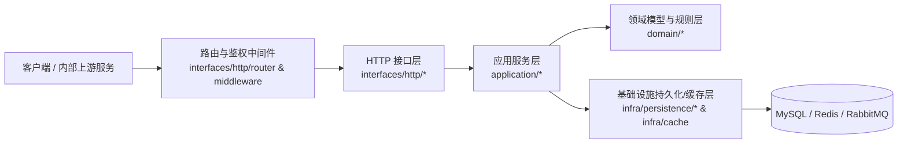
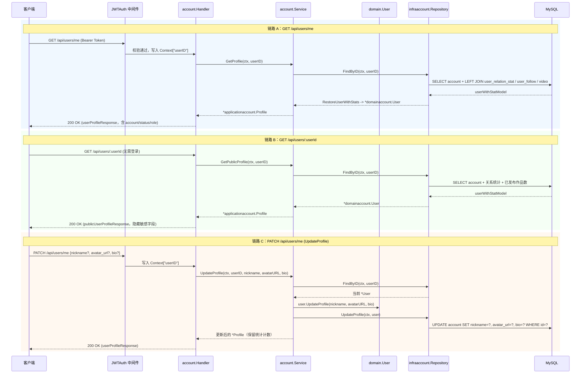
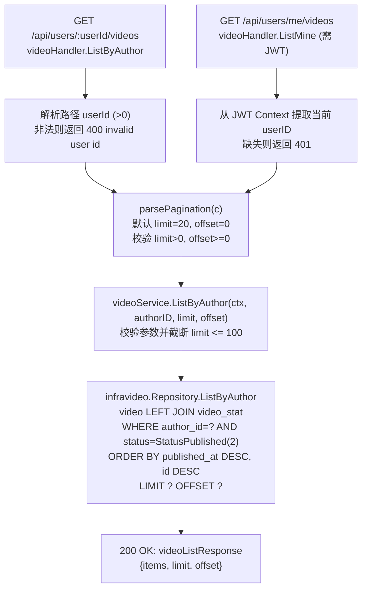
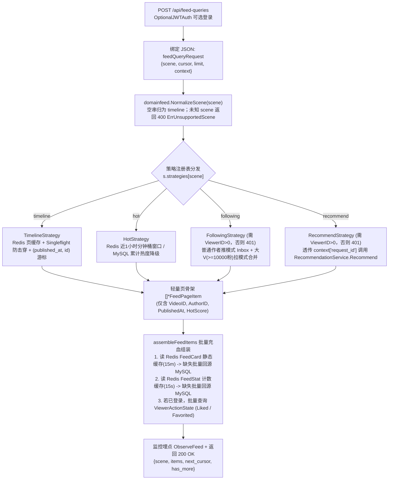
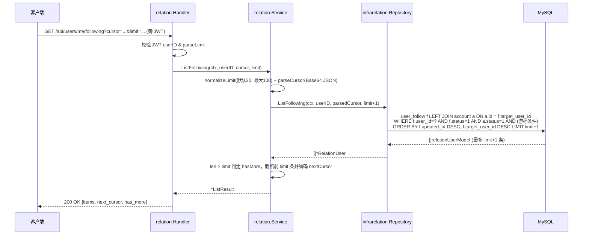
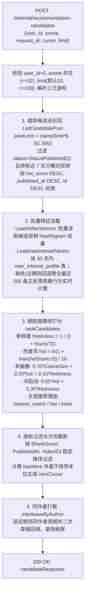
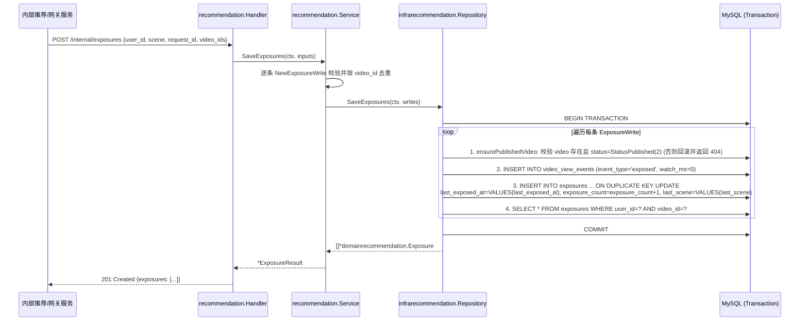
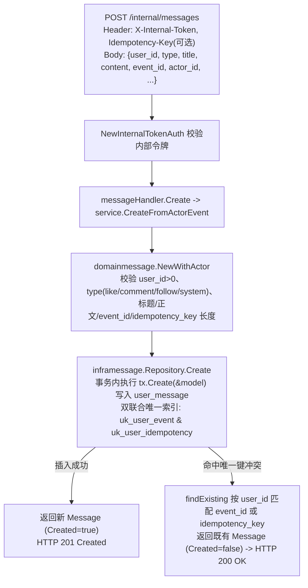

# DreamReel 核心业务与 `/internal` 内部接口链路逻辑详解

## 目录索引

- [1. 架构分层与整体调用规范总览](#1-架构分层与整体调用规范总览)
- [2. 账号资料链路（Account 模块）](#2-账号资料链路account-模块)
  - [2.1 `GET /api/users/me`：查询当前登录用户资料与统计](#21-get-apiusersme查询当前登录用户资料与统计)
  - [2.2 `GET /api/users/:userId`：查询公开用户主页资料](#22-get-apiusersuserid查询公开用户主页资料)
  - [2.3 `PATCH /api/users/me`（`UpdateProfile`）：局部更新当前用户资料](#23-patch-apiusersmeupdateprofile局部更新当前用户资料)
- [3. 用户作品列表链路（Video 模块）](#3-用户作品列表链路video-模块)
  - [3.1 `GET /api/users/:userId/videos`（`ListByAuthor`）：查询指定作者公开作品](#31-get-apiusersuseridvideoslistbyauthor查询指定作者公开作品)
  - [3.2 `GET /api/users/me/videos`（`ListMine`）：查询当前登录用户作品](#32-get-apiusersmevideoslistmine查询当前登录用户作品)
- [4. 复杂上下文 Feed 查询链路（Feed 模块）](#4-复杂上下文-feed-查询链路feed-模块)
  - [4.1 `POST /api/feed-queries`（`Query`）：多场景策略分发与骨架-血液组装](#41-post-apifeed-queriesquery多场景策略分发与骨架-血液组装)
- [5. 社交关系列表链路（Relation 模块）](#5-社交关系列表链路relation-模块)
  - [5.1 `GET /api/users/me/following`（`ListFollowing`）：查询当前用户关注列表](#51-get-apiusersmefollowinglistfollowing查询当前用户关注列表)
  - [5.2 `GET /api/users/me/followers`（`ListFollowers`）：查询当前用户粉丝列表](#52-get-apiusersmefollowerslistfollowers查询当前用户粉丝列表)
- [6. `/internal` 内部服务调用链路体系](#6-internal-内部服务调用链路体系)
  - [6.1 内部鉴权机制：`NewInternalTokenAuth` 常量时间校验](#61-内部鉴权机制newinternaltokenauth-常量时间校验)
  - [6.2 `POST /internal/recommendation-candidates`：推荐候选召回与精排打散](#62-post-internalrecommendation-candidates推荐候选召回与精排打散)
  - [6.3 `POST /internal/exposure-decisions`：近期曝光窗口去重判定](#63-post-internalexposure-decisions近期曝光窗口去重判定)
  - [6.4 `POST /internal/exposures`：批量曝光流水写入与聚合 Upsert](#64-post-internalexposures批量曝光流水写入与聚合-upsert)
  - [6.5 `POST /internal/messages`：内部事件驱动站内消息生成与幂等](#65-post-internalmessages内部事件驱动站内消息生成与幂等)
  - [6.6 `POST /internal/playback-qos-reports`：服务间播放质量 QoS 上报](#66-post-internalplayback-qos-reports服务间播放质量-qos-上报)
- [7. 全链路鉴权、分页与幂等策略汇总表](#7-全链路鉴权分页与幂等策略汇总表)

---

## 1. 架构分层与整体调用规范总览

DreamReel 后端严格遵循 DDD 四层清晰架构（Clean / Layered DDD Architecture），所有外部 `/api` 与内部 `/internal` 请求均沿着单一职责方向自顶向下流转：

各层核心职责边界：
- **路由与中间件层（`interfaces/http/router`、`interfaces/http/middleware`）**：统一装配依赖拓扑，根据接口性质挂载强制登录 `NewJWTAuth`、可选登录 `NewOptionalJWTAuth` 或服务间令牌 `NewInternalTokenAuth`。
- **HTTP 接口层（`interfaces/http/*`）**：只负责解析 Path/Query/Header/JSON Body、提取上下文 `userID`、将应用层结果转换为对外 DTO，并将领域/应用层错误统一映射为 HTTP 状态码（`400` / `401` / `403` / `404` / `409` / `500`）。
- **应用服务层（`application/*`）**：负责用例编排（如分页默认值兜底与最大页大小截断、游标 Base64+JSON 编解码、缓存读写与回源、跨模块策略调用）。
- **领域层（`domain/*`）**：维护业务不变量（如非空校验、长度限制、局部字段指针更新、热度公式、推荐兴趣向量加权平均、行为事件权重等），定义仓储接口 `Repository` 与领域错误。
- **基础设施持久化层（`infra/persistence/*`）**：基于 GORM / SQL 实现仓储接口，封装多表联查、复合索引排序、事务原子性（`Transaction`）以及唯一键冲突回查 / `ON DUPLICATE KEY UPDATE` 逻辑，绝不向上泄漏数据库模型。

---

## 2. 账号资料链路（Account 模块）

涉及核心文件：
- 路由注册：`apps/api/internal/interfaces/http/router/router.go`
- 接口层：`apps/api/internal/interfaces/http/account/handler.go`、`model.go`
- 应用层：`apps/api/internal/application/account/service.go`、`model.go`
- 领域层：`apps/api/internal/domain/account/entity.go`、`repository.go`、`errors.go`
- 持久化层：`apps/api/internal/infra/persistence/account/gorm.go`、`model.go`

### 2.1 `GET /api/users/me`：查询当前登录用户资料与统计

1. **鉴权与入口（`accountHandler.Me`）**：
   - 路由挂载强制鉴权中间件 `NewJWTAuth`，解析 `Authorization: Bearer <token>` 并将 `claims.UserID` 注入 `gin.Context`。
   - Handler 调用 `userIDFromContext(c)` 提取正整数 `userID`；若缺失或非法，返回 `401 Unauthorized`（`{"error": "invalid access token"}`）。
2. **应用层编排（`Service.GetProfile`）**：
   - 校验 `userID > 0`（否则返回 `ErrInvalidUserID` -> `400`）。
   - 调用 `repo.FindByID(ctx, userID)` 获取聚合根 `*domainaccount.User`。若返回 `ErrUserNotFound` 则原样透传（映射为 `404`），其他存储异常封装为 `ErrLoadUserFailed`（映射为 `500`）。
   - 通过 `profileFromDomain(user)` 构造应用层 `Profile`。
3. **持久化联表统计查询（`infraaccount.Repository.FindByID`）**：
   - 使用 `userWithStatSelect()` 在单次 SQL 查询中从 `account` 表聚合用户基础信息与三维统计计数：
     - **关注数 `following_count`**：通过子查询 `SELECT user_id, COUNT(*) FROM user_follow WHERE status = 1 GROUP BY user_id` 实时统计有效关注数，若当前无有效关注子查询记录则回退读取 `user_relation_stat.following_count`，再兜底为 `0`（`COALESCE(active_following.following_count, rs.following_count, 0)`）。
     - **粉丝数 `follower_count`**：同样按 `target_user_id` 实时统计有效粉丝数，无记录时回退 `user_relation_stat.follower_count` 并兜底为 `0`（`COALESCE(active_followers.follower_count, rs.follower_count, 0)`）。
     - **作品数 `work_count`**：通过子查询统计 `video` 表中 `status = 2`（`domainvideo.StatusPublished` 已发布）的视频总数。
   - 使用 `RestoreUserWithStats` 还原领域对象，并对负值计数执行 `clampCount` 归零保护。
4. **响应输出**：返回 `200 OK` 及完整 `userProfileResponse`（包含 `id`、`account`、`nickname`、`avatar_url`、`bio`、`status`、`role`、`following_count`、`follower_count`、`work_count`）。

### 2.2 `GET /api/users/:userId`：查询公开用户主页资料

1. **无需登录态（`accountHandler.Get`）**：
   - 通过 `parsePositiveUserID(c.Param("userId"))` 解析路径参数，非正整数直接返回 `ErrInvalidUserID`（`400 Bad Request`）。
2. **应用层复用（`Service.GetPublicProfile`）**：
   - 直接复用 `GetProfile` 底层查询链路，获取包含关注数、粉丝数、公开作品数的完整 `Profile`。
3. **接口层脱敏隔离（`publicProfileResponse`）**：
   - 转换为 `publicUserProfileResponse` 返回给前端，**主动剥离 `account`（登录账号）、`status`（账号状态）、`role`（权限角色）三个内部/隐私字段**，仅暴露主页展示所需的公开资料与社交统计数据。

### 2.3 `PATCH /api/users/me`（`UpdateProfile`）：局部更新当前用户资料

1. **指针语义区分“未传”与“置空”（`UpdateProfileRequest`）**：
   - 请求体字段全部定义为指针类型：`Nickname *string`、`AvatarURL *string`、`Bio *string`。
   - 当客户端 JSON 未携带某字段时指针为 `nil`（保持原值不变）；携带空字符串 `""` 时指针非空（可执行清空头像或简介操作）。
2. **领域层不变量校验（`User.UpdateProfile`）**：
   - **空更新拦截**：若 `nickname == nil && avatarURL == nil && bio == nil`，返回 `ErrEmptyProfileUpdate`（`400 Bad Request`），避免无意义的数据库写操作。
   - **昵称非空约束**：若传入了 `nickname`，去除首尾空白后不能为空字符串，否则返回 `ErrEmptyNickname`（`400`）。
   - **头像与简介清洗**：若传入了 `avatarURL` 或 `bio`，执行 `strings.TrimSpace` 后允许更新为空字符串（即支持用户清空简介或头像）。
3. **持久化定向更新（`Repository.UpdateProfile`）**：
   - 先通过 `FindByID` 加载现有用户及其统计计数，在内存中完成领域方法变更校验后，调用 `UpdateProfile` 仅更新 `account` 表的 `nickname`、`avatar_url`、`bio` 三列（绝不触碰 `account`、`password_hash`、`role`、`status`）。
   - 若 `RowsAffected == 0` 且确认用户记录不存在，则返回 `ErrUserNotFound`（`404`）；成功后返回带最新资料和原有统计计数的 `userProfileResponse`。

---

## 3. 用户作品列表链路（Video 模块）

涉及核心文件：
- 接口层：`apps/api/internal/interfaces/http/video/handler.go`、`model.go`
- 应用层：`apps/api/internal/application/video/service.go`
- 领域层：`apps/api/internal/domain/video/repository.go`、`errors.go`
- 持久化层：`apps/api/internal/infra/persistence/video/gorm.go`、`model.go`

### 3.1 `GET /api/users/:userId/videos`（`ListByAuthor`）：查询指定作者公开作品

1. **接口层参数解析（`videoHandler.ListByAuthor` & `parsePagination`）**：
   - 解析路径参数 `:userId`，若非正整数则返回 `400`（`{"error": "invalid user id"}`）。
   - 解析 Query 分页参数：
     - `limit`：未传时默认为 `defaultListLimit = 20`；若传入非整数或 `<= 0`，返回 `ErrInvalidLimit`（`400`）。
     - `offset`：未传时默认为 `0`；若传入非整数或 `< 0`，返回 `ErrInvalidOffset`（`400`）。
2. **应用层保护（`videoService.ListByAuthor`）**：
   - 二次校验 `authorID > 0`、`limit > 0`、`offset >= 0`。
   - **最大页大小保护**：若 `limit > 100`，强制截断为 `100`，防止单次大页查询拖垮数据库。
3. **持久化查询与联表组装（`infravideo.Repository.ListByAuthor`）**：
   - 查询 `video AS v` 左连接 `video_stat AS vs ON vs.video_id = v.id`。
   - 过滤条件 `v.author_id = ? AND v.status = 2`（`domainvideo.StatusPublished`，仅返回已发布视频，草稿/下线/软删除视频自动隐藏）。
   - 严格按照 `v.published_at DESC, v.id DESC` 复合倒序排列（解决同一秒发布多条视频时的翻页确定性问题）。
   - 将每行 `videoWithStatModel`（含点赞/评论/收藏计数及 AIGC 元数据 `model_name`、`model_params`、`ai_style_tag`、`origin_video_id`）还原为领域对象，最终返回 `{items, limit, offset}`。

### 3.2 `GET /api/users/me/videos`（`ListMine`）：查询当前登录用户作品

- 路由挂载 `authMiddleware`（需携带有效 Access Token）。
- `videoHandler.ListMine` 从 JWT 上下文中获取当前登录用户的 `userID` 作为 `authorID`，随后**完全复用** `parsePagination` -> `service.ListByAuthor` -> `videoListResponseFromDomain` 链路，确保“查看自己主页作品”与“查看他人主页作品”具备完全一致的分页与排序行为。

---

## 4. 复杂上下文 Feed 查询链路（Feed 模块）

涉及核心文件：
- 接口层：`apps/api/internal/interfaces/http/feed/handler.go`、`model.go`
- 应用层：`apps/api/internal/application/feed/service.go`、`model.go`、`utils.go` 及各场景 Strategy 实现
- 领域层：`apps/api/internal/domain/feed/entity.go`、`errors.go`
- 持久化与缓存层：`apps/api/internal/infra/persistence/feed/gorm.go`、`apps/api/internal/infra/cache/`

### 4.1 `POST /api/feed-queries`（`Query`）：多场景策略分发与骨架-血液组装

相比简单的 `GET /api/feed-items`（仅能通过 URL Query 传递短参数），`POST /api/feed-queries` 通过 JSON 请求体接收结构化的复杂查询上下文（`ClientContext`），专为个性化推荐追踪（如 `request_id`、设备环境信息等）演进而设计。

**逐层核心设计亮点**：
1. **可选鉴权（`NewOptionalJWTAuth`）**：
   - 未登录访客可正常请求 `timeline` 与 `hot` 场景；若携带合法 Bearer Token 则自动解析 `ViewerID` 用于点亮卡片上的“已点赞/已收藏”状态，并解锁 `following` 与 `recommend` 个性化场景（未登录访问后两者将返回 `ErrViewerRequired` -> `401 Unauthorized`）。
2. **请求体校验与场景归一化**：
   - `feedQueryRequest` 包含 `scene`、`cursor`、`limit`（`*int`，`nil` 交由应用层默认取 `10`，`<= 0` 直接返回 `400`）和 `context`（`map[string]string`）。
   - `NormalizeScene` 仅将空白字符串转换为默认场景 `timeline`，若客户端传入非法场景名（如 `"unknown"`），不会静默吞掉错误，而是由 `Service.GetFeed` 精准拦截并返回 `400 unsupported feed scene`，同时记录 Prometheus 观测指标 `metrics.ObserveFeed`。
3. **客户端上下文透传**：
   - 在 `recommend` 场景下，`RecommendStrategy` 通过 `clientContextValue(req.ClientContext, "request_id")` 提取前端请求追踪号并传入推荐服务，串联起推荐召回、曝光判定与行为上报全生命周期。
4. **骨架与血液分离（Page Skeleton + Batch Hydration）**：
   - 各场景策略只产出轻量的 `FeedPageItem` 列表，随后统一进入 `assembleFeedItems`：分别以 15 分钟 TTL 缓存低频变动的视频/作者静态资料（`FeedCard`）、以 15 秒短 TTL 缓存高频变动的互动计数（`FeedStat`），最后按观看者 ID 批量水合点赞/收藏状态，兼顾高并发吞吐与数据实时性。

---

## 5. 社交关系列表链路（Relation 模块）

涉及核心文件：
- 接口层：`apps/api/internal/interfaces/http/relation/handler.go`、`model.go`、`utils.go`
- 应用层：`apps/api/internal/application/relation/service.go`、`utils.go`
- 领域层：`apps/api/internal/domain/relation/entity.go`、`repository.go`、`errors.go`
- 持久化层：`apps/api/internal/infra/persistence/relation/gorm.go`、`model.go`

### 5.1 `GET /api/users/me/following`（`ListFollowing`）：查询当前用户关注列表

1. **鉴权与参数校验**：需 JWT 登录态；`limit` 未传时由应用层 `normalizeLimit` 默认设为 `20`，最大不超过 `100`；若传入 `limit <= 0` 则在接口层立即返回 `400`。
2. **复合游标解析（`parseCursor`）**：
   - 游标载荷包含 `followed_at`（RFC3339Nano 时间戳）与 `user_id`（目标用户 ID），使用 Base64 RawURL 编码（兼容标准 Base64 解码）。
3. **`limit + 1` 探针查询与稳定排序（`Repository.ListFollowing`）**：
   - SQL 查询 `user_follow AS f` 左连接 `account AS a ON a.id = f.target_user_id`，过滤 `f.user_id = ? AND f.status = 1 AND a.status = 1`（仅展示 `FollowStatusActive = 1` 有效关注且账号状态 `StatusNormal = 1` 的正常用户；已取关记录因 `FollowStatusCanceled = 2` 被过滤）。
   - 若携带游标，追加严格单调递减过滤条件：
     `(f.updated_at < ? OR (f.updated_at = ? AND f.target_user_id < ?))`。
   - 排序键：`ORDER BY f.updated_at DESC, f.target_user_id DESC`（最新关注或重新关注的用户排在最前）。
   - 应用层请求 `limit + 1` 条记录：若返回条数 `> limit`，则 `has_more = true` 并截取前 `limit` 条；只要当页 `len(items) > 0`，即取最后一条的 `(FollowedAt, UserID)` 编码为 `next_cursor`，由 `has_more` 标识是否存在后续数据（当页为空时 `next_cursor` 为 `""`）。

### 5.2 `GET /api/users/me/followers`（`ListFollowers`）：查询当前用户粉丝列表

- 与 `ListFollowing` 对称，入口为 `relationHandler.ListFollowers` -> `service.ListFollowers` -> `repo.ListFollowers`。
- **持久化查询差异**：
  - 联表方向反转：`user_follow AS f` 左连接 `account AS a ON a.id = f.user_id`（连接发起关注的粉丝用户资料）。
  - 过滤条件：`f.target_user_id = ? AND f.status = 1 AND a.status = 1`。
  - 游标过滤条件：`(f.updated_at < ? OR (f.updated_at = ? AND f.user_id < ?))`。
  - 排序键：`ORDER BY f.updated_at DESC, f.user_id DESC`。

---

## 6. `/internal` 内部服务调用链路体系

`/internal` 路由组专为微服务拆分演进、离线/准实时 Worker 回调、推荐引擎独立部署与网关上报场景提供标准化的内部 HTTP 契约。

### 6.1 内部鉴权机制：`NewInternalTokenAuth` 常量时间校验

涉及文件：`apps/api/internal/interfaces/http/middleware/jwtauth.go`、`apps/api/configs/config.yaml`

- 配置项 `internal.token` 定义服务间共享密钥。
- 中间件 `NewInternalTokenAuth(token)` 校验逻辑：
  1. 若服务端未配置 `internal.token`（空串），直接拒绝所有请求并返回 `401 Unauthorized`（`{"message": "internal token is required"}`），防止因漏配导致内部写接口裸奔。
  2. 从请求头读取 `X-Internal-Token`，使用标准库 `crypto/subtle.ConstantTimeCompare` 执行**常量时间字节比对**，彻底杜绝基于响应耗时的侧信道计时攻击（Timing Attack）；不匹配则返回 `401`（`{"message": "invalid internal token"}`）。

---

### 6.2 `POST /internal/recommendation-candidates`：推荐候选召回与精排打散

涉及文件：
- 接口层：`apps/api/internal/interfaces/http/recommendation/handler.go`、`model.go`
- 应用层：`apps/api/internal/application/recommendation/service.go`、`model.go`、`utils.go`
- 领域层：`apps/api/internal/domain/recommendation/model.go`、`repository.go`
- 持久化层：`apps/api/internal/infra/persistence/recommendation/gorm.go`

**关键实现细节**：
- **游标生成时机**：`nextCursor` 严格在 `interleaveByAuthor`（同作者打散）**之前**根据精排顺序的最后一条候选生成，确保下一页调用 `filterByCursor` 时分页边界在数学上严格单调无遗漏。
- **在线画像兜底**：当离线/异步画像表 `user_interest_profile` 尚无记录时，`LoadUserInterestVector` 会自动读取 `video_view_events` 中近 30 天的 `play`/`complete` 正反馈事件（甚至在 `video_embedding` 未落库时使用 `HashNgramVectorizer` 基于视频标题和描述即时向量化），按完播/观看时长加权聚合出实时兴趣向量。

---

### 6.3 `POST /internal/exposure-decisions`：近期曝光窗口去重判定

涉及文件：`apps/api/internal/interfaces/http/recommendation/handler.go`、`apps/api/internal/application/recommendation/service.go`

1. **请求校验与去重（`NewExposureDecisionRequest`）**：
   - 接收 `{user_id, scene, request_id, video_ids}`。
   - 校验 `user_id > 0`、`scene` 合法且所有 `video_id > 0`，同时保持原顺序对 `video_ids` 去重；若列表为空则直接返回空决策数组 `[]`（不查库）。
2. **7 天时间窗口批量查询（`Repository.ListRecentExposures`）**：
   - 计算截止时间 `since = now - 7天`（`RecentExposureWindow = 7 * 24h`）。
   - 执行单条 SQL：`SELECT * FROM exposures WHERE user_id = ? AND video_id IN ? AND last_exposed_at >= ?`，命中复合索引 `idx_user_last_exposed` / `uk_user_video`。
3. **逐条生成判定结果（`Service.DecideExposures`）**：
   - 若某视频在窗口内存在曝光记录：`allowed = false`，`reason = "recently_exposed"`，并附带 `last_exposed_at` 时间戳。
   - 若未命中近期曝光：`allowed = true`，`reason = "fresh"`，`last_exposed_at` 为空。
   - 返回 `200 OK` 及完整 `decisions` 列表。

---

### 6.4 `POST /internal/exposures`：批量曝光流水写入与聚合 Upsert

涉及文件：`apps/api/internal/infra/persistence/recommendation/gorm.go`（`SaveExposures`）

**事务一致性保证**：
- 整个批次在同一个数据库事务中执行：若批次中任意一个 `video_id` 不存在或已下架，`ensurePublishedVideo` 返回 `ErrVideoNotFound`，事务整体回滚，HTTP 层精准返回 `404 Not Found`（`{"error": "video not found"}`），绝不会产生孤立的脏曝光记录。
- 同时维护两张表：`video_view_events` 保存不可变的曝光行为明细流水，`exposures` 通过 `(user_id, video_id)` 唯一索引执行原子累加 `exposure_count = exposure_count + 1`，支撑毫秒级在线曝光去重查询。

---

### 6.5 `POST /internal/messages`：内部事件驱动站内消息生成与幂等

涉及文件：
- 接口层：`apps/api/internal/interfaces/http/message/handler.go`、`model.go`
- 应用层：`apps/api/internal/application/message/service.go`
- 领域层：`apps/api/internal/domain/message/entity.go`
- 持久化层：`apps/api/internal/infra/persistence/message/gorm.go`、`model.go`

**核心设计要点**：
1. **双唯一索引协同防重**：`user_message` 表同时维护 `uk_user_event(user_id, event_id)` 与 `uk_user_idempotency(user_id, idempotency_key)` 两个联合唯一索引（空串经 `optionalString` 转为 `NULL` 以允许无幂等键的普通系统通知插入），无论上游通过 MQ 事件 `event_id` 还是 HTTP 头 `Idempotency-Key` 重试，均可实现严格幂等。
2. **乐观直插 + 唯一键冲突回查**：直接执行事务插入（避免每次正常写入多一次前置 `SELECT` 开销），当数据库返回唯一键冲突（`isDuplicateKeyError`）时自动调用 `findExisting` 回查既有记录：首次创建返回 `201 Created`，重放命中返回 `200 OK`。

---

### 6.6 `POST /internal/playback-qos-reports`：服务间播放质量 QoS 上报

涉及文件：
- 接口层：`apps/api/internal/interfaces/http/playback/handler.go`、`model.go`
- 应用层：`apps/api/internal/application/playback/service.go`
- 领域层：`apps/api/internal/domain/playback/entity.go`
- 持久化层：`apps/api/internal/infra/persistence/playback/gorm.go`、`model.go`

1. **与公共上报接口 `POST /api/playback-qos-reports` 的区别与复用**：
   - **公共接口（`CreateQoSReport`）**：面向前端客户端，通过 `JWTAuth` 鉴权，**强制使用 JWT 中的 `userID`**（忽略请求体中的 `user_id`，防止客户端伪造他人上报）。
   - **内部接口（`CreateInternalQoSReport`）**：面向内部边缘网关、流媒体节点或日志聚合服务，通过 `X-Internal-Token` 鉴权，**读取请求体中的 `req.UserID`**，随后与公共接口共享 `createQoSReportWithRequest` -> `service.CreateQoSReport` 核心逻辑。
2. **领域校验与幂等落库**：
   - 校验 `user_id >= 0`（负数返回 `400 ErrInvalidUserID`）、`video_id > 0`、`first_frame_ms >= 0`（可选指针，区分首帧未出与 0ms）、`stutter_count >= 0`、`watch_ms >= 0` 以及 `Idempotency-Key <= 128`。
   - 写入 `playback_qos_log` 表（联合唯一索引 `uk_user_idempotency(user_id, idempotency_key)`）：首次直接插入成功返回 `201 Created`；若触发唯一键冲突，则在事务内通过 `findExistingQoS`（`FOR UPDATE`）回查既有流水并返回 `200 OK`。

---

## 7. 全链路鉴权、分页与幂等策略汇总表

| 接口路径 | HTTP 方法 | 鉴权策略 | 分页 / 写入模式 | 成功状态码 | 核心数据表 / 缓存 |
| :--- | :--- | :--- | :--- | :--- | :--- |
| `/api/users/me` | `GET` | `NewJWTAuth` | 单实体联表聚合查询 | `200 OK` | `account`, `user_relation_stat`, `user_follow`, `video` |
| `/api/users/:userId` | `GET` | 无（公开） | 单实体联表查询 + 响应脱敏 | `200 OK` | `account`, `user_relation_stat`, `user_follow`, `video` |
| `/api/users/me` | `PATCH` | `NewJWTAuth` | 指针局部更新（`nil` 保留原值） | `200 OK` | `account` |
| `/api/users/:userId/videos` | `GET` | 无（公开） | Offset 分页（默认 `20`，上限 `100`） | `200 OK` | `video`, `video_stat` |
| `/api/users/me/videos` | `GET` | `NewJWTAuth` | Offset 分页（默认 `20`，上限 `100`） | `200 OK` | `video`, `video_stat` |
| `/api/feed-queries` | `POST` | `NewOptionalJWTAuth` | 策略分发 + 复合游标分页 | `200 OK` | Redis 页/卡片/计数缓存 + MySQL 多表回源 |
| `/api/users/me/following` | `GET` | `NewJWTAuth` | `(updated_at, target_user_id)` 游标分页 | `200 OK` | `user_follow`, `account` |
| `/api/users/me/followers` | `GET` | `NewJWTAuth` | `(updated_at, user_id)` 游标分页 | `200 OK` | `user_follow`, `account` |
| `/internal/recommendation-candidates` | `POST` | 内网隔离（无 Token 中间件） | `(rank_score, published_at, video_id)` 游标 | `200 OK` | `video`, `video_stat`, `exposures`, `video_embedding`, `user_interest_profile`, `video_view_events` |
| `/internal/exposure-decisions` | `POST` | 内网隔离（无 Token 中间件） | 7 天窗口批量去重查询 | `200 OK` | `exposures` |
| `/internal/exposures` | `POST` | 内网隔离（无 Token 中间件） | 事务批量插入流水 + 聚合 Upsert | `201 Created` | `video`, `video_view_events`, `exposures` |
| `/internal/messages` | `POST` | `NewInternalTokenAuth` | `uk_user_event` / `uk_user_idempotency` 幂等写入 | `201` / `200` | `user_message` |
| `/internal/playback-qos-reports` | `POST` | `NewInternalTokenAuth` | `uk_user_idempotency` 幂等写入 | `201` / `200` | `playback_qos_log` |
